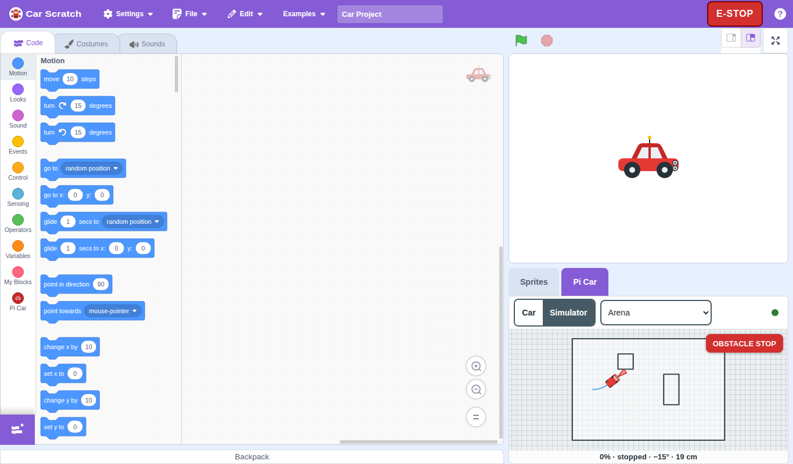
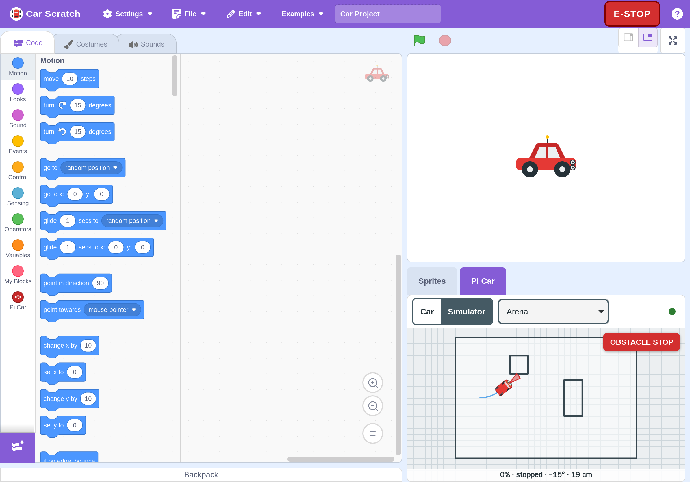

# Car Scratch

Program a SunFounder PiCar-S robot car with Scratch blocks — from a desktop browser or an iPad — with a
live animation of what the car is doing and a built-in simulator for working without the car.

```
 Browser (desktop / iPad)                         Raspberry Pi 3 on the car (http://picar.local:8080)
 ┌──────────────────────────────────┐   HTTP      ┌────────────────────────────────────────┐
 │ Car Scratch editor (Scratch 3)   │◄────────────│ picar_server (Python, aiohttp)         │
 │  "Pi Car" blocks · Car Monitor   │◄──── /ws ──►│  safety · arbitration · simulator · HAL │
 │  Examples · Save/Open on car     │     /api    │  PCA9685 · TB6612 · ultrasonic · sensors│
 └──────────────────────────────────┘             └────────────────────────────────────────┘
```

All safety (obstacle stop, watchdog, e-stop, reverse limits) is enforced **on the car**, never in the
browser. See [docs/safety.md](docs/safety.md).

| Desktop | iPad (landscape) |
|---|---|
|  |  |

## Layout

| Path | What |
|---|---|
| `editor/` | Scratch editor monorepo (squashed subtree of `scratchfoundation/scratch-editor`) + Car Scratch changes |
| `server/picar_server/` | car server: WebSocket protocol, safety, simulator, hardware layer |
| `server/tools/` | `carctl.py` (terminal dashboard and keyboard driving, [docs/carctl.md](docs/carctl.md)), `wsclient.py` (drive the car from a terminal), `calib.py` |
| `examples/` | example project generator (`tools/pack.py`) and definitions |
| `e2e/` | Playwright tests (Chromium + WebKit iPad profiles) |
| `workstation/` | the `car` shortcut for your computer (`car.ps1` for PowerShell, `car` for bash), see [docs/carctl.md](docs/carctl.md#shortcuts-the-car-command) |
| `deploy/` | `deploy.sh`, `pi-setup.sh`, systemd units, `pi-tune.sh` / `pi-slim.sh` (headless OS, [docs/pi-tune.md](docs/pi-tune.md)), `wifi-setup.sh` (direct WiFi hotspot, [docs/wifi.md](docs/wifi.md)), `calibration/picar.json` |
| `docs/` | [index](docs/README.md), [architecture](docs/architecture.md), [components](docs/components.md), [protocol](docs/protocol.md), [contracts](docs/contracts.md), [decisions](docs/decisions.md), [safety](docs/safety.md), [iPad](docs/ipad.md), [calibration](docs/calibration.md), [on-car checklist](docs/on-car-checklist.md), [kids' guide](docs/kids-guide.md), [carctl](docs/carctl.md), [WiFi hotspot](docs/wifi.md), [Pi tuning](docs/pi-tune.md) |

## Develop and test (Docker only)

```sh
docker compose run --rm server-test                     # Python server tests
docker compose run --rm editor-test                     # scratch-vm Tap + scratch-gui Jest tests for Car Scratch
docker buildx build -f docker/editor.Dockerfile --target www --build-arg BUILD_SHA=$(git rev-parse --short=12 HEAD) \
    --output type=local,dest=out/www .                  # editor build (~5 min); deploy.sh refuses a bundle without the HEAD sha
docker run --rm -v "$PWD:/repo" -w /repo python:3.13-slim python3 examples/tools/pack.py out/examples
docker compose up -d sim-server                         # http://localhost:18080 (compose maps 18080:8080) — simulator, no car needed
docker compose run --rm e2e                             # Playwright against the simulator
```

## Deploy to the car

One-time on the Pi (needs the owner's sudo password): `deploy/pi-setup.sh`. Then from the workstation:
`docker compose run --rm deploy` (dry run) and `docker compose run --rm deploy sh deploy/deploy.sh`.
Follow [docs/on-car-checklist.md](docs/on-car-checklist.md) the first time.

Maintenance access without the owner's sudo password: `deploy/ops-user-setup.sh` (run once with sudo) creates
`carops`, a key-only, LAN-only account with passwordless sudo for root-level deploy and debug steps
(`sudo sh ops-user-setup.sh --remove` deletes it again).

## Licence

AGPL-3.0-only (the Scratch editor is AGPL-3.0). The car serves the exact source of what it runs at
`/source/`. Car Scratch is not affiliated with or endorsed by the Scratch Foundation; see [NOTICE](NOTICE).
