# Car Scratch architecture

Car Scratch has two halves. The **editor** is a fork of the Scratch 3 editor (`editor/`, built into static
files) with a Pi Car block extension, a Car Monitor and car-specific menus. The **car server**
(`server/picar_server`, Python + aiohttp) runs on the Raspberry Pi 3 B+ of the SunFounder PiCar-S, serves the
editor, and owns the motors, the sensors, the simulator and every safety rule. The browser can ask for motion;
it never has to remember to stop.

This page shows how the parts fit together. For details see:

- [components.md](components.md): one section per component (files, interfaces, tests, gotchas).
- [protocol.md](protocol.md): the wire protocol (WebSocket + REST), authoritative.
- [contracts.md](contracts.md): safety semantics, the HAL, the simulator world format, `CarLink`, the blocks.
- [safety.md](safety.md): the safety guide for the people driving the car.

## 1. System context

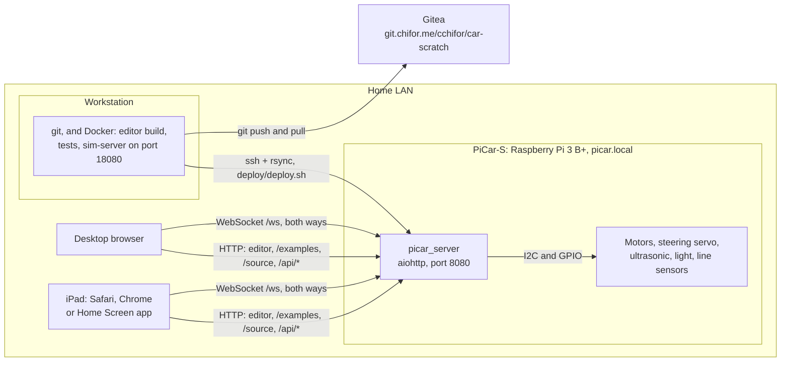

Everything a browser needs comes from one origin, `http://picar.local:8080`, on the home LAN only (no internet
exposure). The workstation never talks to the car at run time: it builds the editor and the examples in Docker
and deploys a release over SSH.

| URL on the car | What |
|---|---|
| `/` and `/{path}` | the editor build (`www/`), precompressed `.gz` files served when the browser accepts gzip |
| `/ws` | the WebSocket: `hello`/`welcome`, commands, `tel` at 20 Hz, events ([protocol.md](protocol.md) sections 2 to 5) |
| `POST /api/estop` | latches the e-stop on the shared car; the E-STOP button sends it next to the WebSocket `estop` |
| `GET /api/status` | version, deployed `sha`, car availability, client counts (the deploy health check reads it) |
| `/api/projects`, `/api/projects/{name}.sb3` | "Save to car" / "Open from car" storage |
| `/examples/index.json`, `/examples/{id}.sb3` | the bundled example projects |
| `/source/` | the AGPL source tarball of the deployed commit |

The Host header must be in the allow-list and a present `Origin` must match `Host` (DNS-rebinding defence) for
`/ws` and every unsafe REST method; see [protocol.md](protocol.md) section 1.

## 2. Components

### 2.1 Editor side

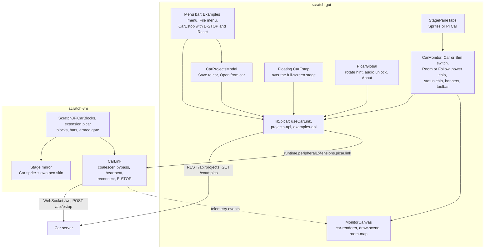

The VM extension owns the one `CarLink` per page; every GUI piece finds it through
`vm.runtime.peripheralExtensions.picar.link` (the `useCarLink` hook) and never opens its own socket. The Car
Monitor canvas takes telemetry straight from the link and paints it in a `requestAnimationFrame` loop, so React
only re-renders when a coarse flag (e-stop, hold, power, role) changes.

### 2.2 Car side

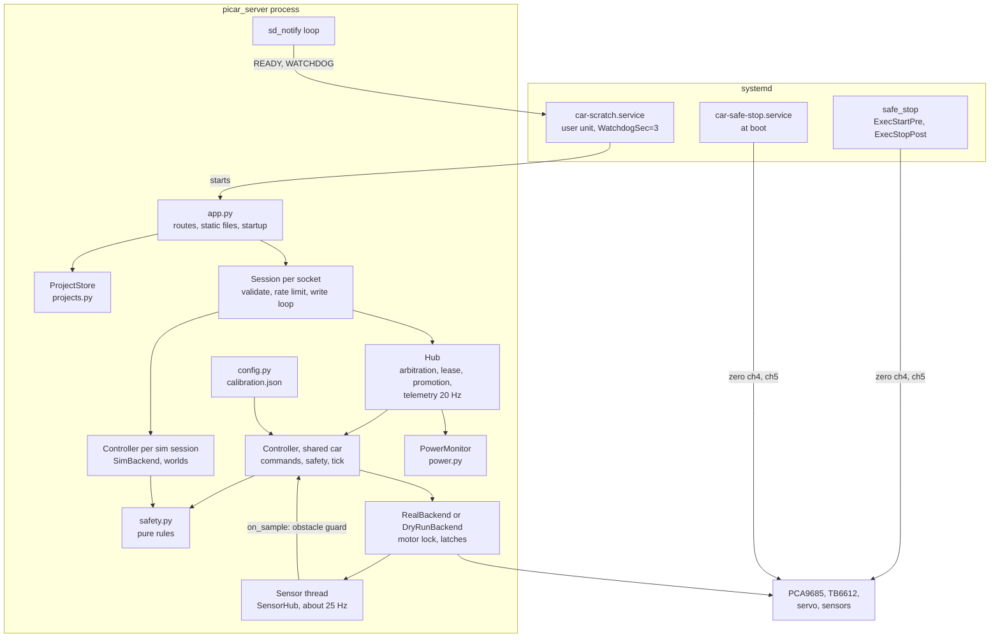

There is one shared-car `Controller` per server and one private `Controller` + `SimBackend` per simulator session
(at most 4). The same `Controller` class and the same `safety.py` rules run in both, so the simulator, the pytest
suite and the e2e tests exercise the code that drives the real car. `--hardware` picks the backend at start:
`auto` and `real` load `RealBackend`, `dryrun` reads the real sensors but only logs motor writes, `sim` puts a
simulated car behind the shared controller (the Docker `sim-server`), `none` runs without a car.

## 3. A timed drive, end to end

The block "drive forward at 40 % for 1 seconds" (`driveFor`) on the real car:

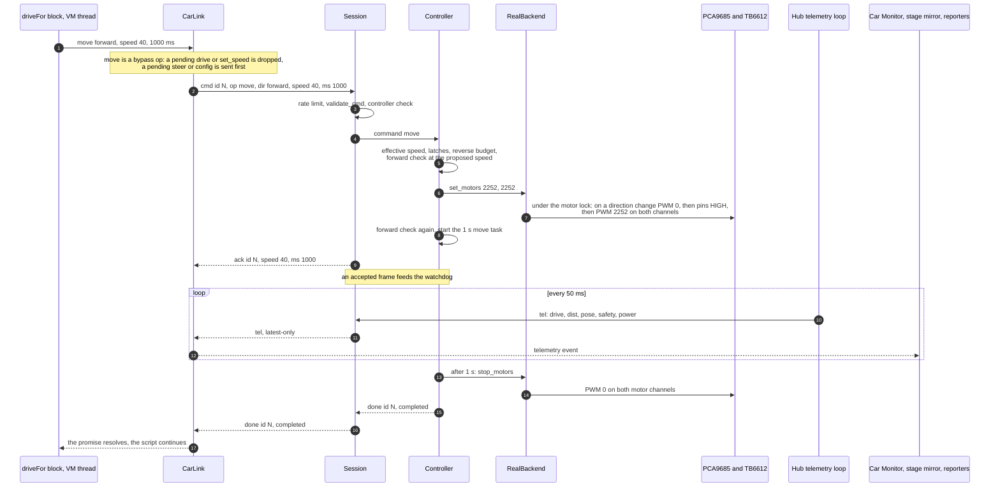

The timed move runs on the server, so a browser that freezes or disconnects cannot leave the motors running.
Speed 40 becomes duty 55 % (2252 of 4095) with the default floor 25 % and ceiling 100 %
([contracts.md](contracts.md) section 3). Plain `drive` blocks go through the 50 ms coalescer instead and get only
an `ack`; only `move` gets a `done`.

### Obstacle stop without the browser

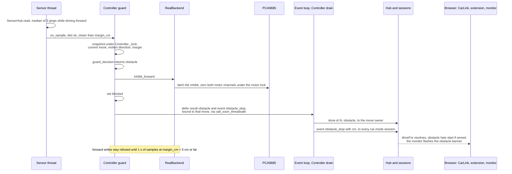

The motors stop in the sensor thread, before the event loop hears about it. The loop only reports what already
happened; a stalled loop or a lost browser cannot delay the stop.

## 4. Concurrency on the car

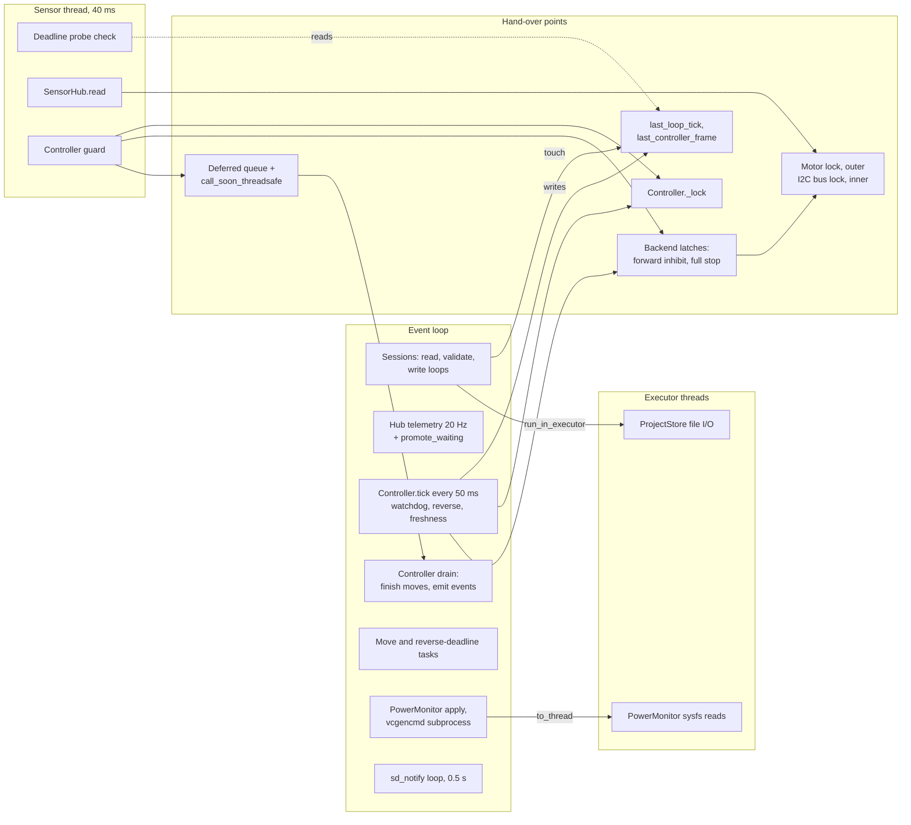

The server has one event loop, one sensor thread (`picar-sensors`, real and dry-run backends only) and
short-lived worker threads from asyncio's default executor. The sensor thread can stop the motors on its own at any time; everything
else that needs the loop (events, `done`, `role`) is handed over through a queue.

| Thread | Owns | Hands over through |
|---|---|---|
| Event loop | Sessions and arbitration, the controller's motion intent (`_dir`, `_eff`, timed moves, the motion generation `_gen`, the reverse budget), `cfg`, the e-stop and hold flags it sets, telemetry, every simulator backend and its physics, PowerMonitor state and events, sd_notify | Writes `last_loop_tick` (every tick) and `last_controller_frame` (`touch()` on an accepted controller frame); mirrors e-stop/hold/hw_fault into the backend with `_sync_latch()`; checks `_gen` before a timer touches the motors |
| Sensor thread (`_HardwareBase._run`) | The ultrasonic pin (GPIO5) and its timing, `SensorHub` state, sample production, the deadline check | Writes the controller's sensor fields (`_sample`, `_last_good_t`, `_last_ok`, ...) and `blocked` under `Controller._lock`; stops motors through the backend (`inhibit_forward`, `stop_motors`, both under the motor lock); latches hold or `hw_fault` via `_deadline_latch`; queues results with `_defer` and schedules `_drain` with `loop.call_soon_threadsafe` |
| Worker threads | Only file reads (hwmon `rpi_volt` alarm, thermal zone, `/proc/uptime`, load average) and project file I/O | Return values to the loop; the loop applies them (`PowerMonitor._apply`) |

Rules that keep this safe (verified in [controller.py](../server/picar_server/controller.py),
[hal/real.py](../server/picar_server/hal/real.py), [hal/sensors.py](../server/picar_server/hal/sensors.py),
[power.py](../server/picar_server/power.py), [session.py](../server/picar_server/session.py)):

- **Lock order:** the motor lock (outer) is held across a whole motor operation; the I2C bus lock (inner) is
  taken per transaction. Never take the motor lock while holding the bus lock. `stop_motors()` waits at most
  0.2 s for the motor lock and returns `False` instead (the controller then latches `hw_fault`).
- **Latches beat writes:** `set_motors()` checks the full-stop latch and the forward inhibit under the motor
  lock, so a stop can never interleave with a set, and a write that loses the race writes zero.
- **Deadline probe:** the sensor thread calls `Controller._deadline_probe()` every iteration while the motors run.
  If the loop has not ticked for 1 s, or the attached controller has been silent for more than `wd_ms` (750 ms),
  it stops the motors itself and calls `_deadline_latch()` (hold, reason `watchdog`; `hw_fault` if the stop could
  not be confirmed). There is no separate liveness thread.
- **Deferred results are bound to a move object:** a stop from the sensor thread finishes only the move that
  was current when it stopped the motors; a move started afterwards is never touched.
- **The sensor thread never dies with the wheels turning:** every exception stops the motors, and its `finally`
  stops them again. It sets the process-wide `sys.setswitchinterval(0.0005)` so GIL hand-offs do not stretch the
  echo timing.
- **The line follower is probed only while the motors are stopped** (it waits at most 50 ms for the motor lock,
  else skips that sample), and only with `line_enabled` in the calibration.
- **Recurring I/O stays off the loop:** PowerMonitor runs its sysfs reads with `asyncio.to_thread` (skipping a
  pass while the previous read is still stuck) and `vcgencmd` as an async subprocess with a timeout; project
  files go through `run_in_executor`. Only one-off work runs on the loop: the startup reads and a
  `calibrate` save.
- **The simulator has no sensor thread:** `SimBackend` samples on the loop at 25 Hz and the controller runs the
  deadline check inside the guard itself.

## 5. Safety layers

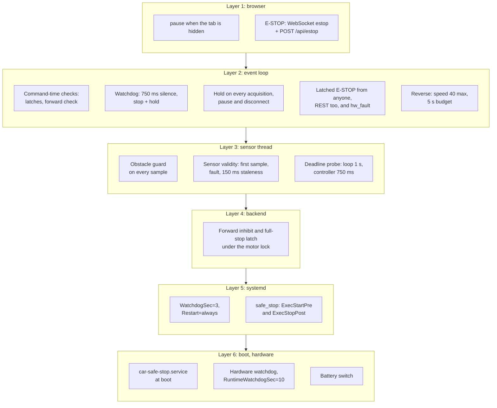

Each layer works without the ones above it. The browser layer is a convenience only: the server never relies on
it. The sensor thread stops the car
when the loop stalls, systemd restarts a hung server and zeroes the motors after any exit, and the SoC watchdog
reboots a hung Pi, after which `car-safe-stop.service` zeroes the motors again. The rules and their numbers are
specified in [contracts.md](contracts.md) section 1; what they mean for the people at the car is in
[safety.md](safety.md).

## 6. Control arbitration

Only car-mode sessions compete for the car; a sim session always controls its own private simulator. The seat:

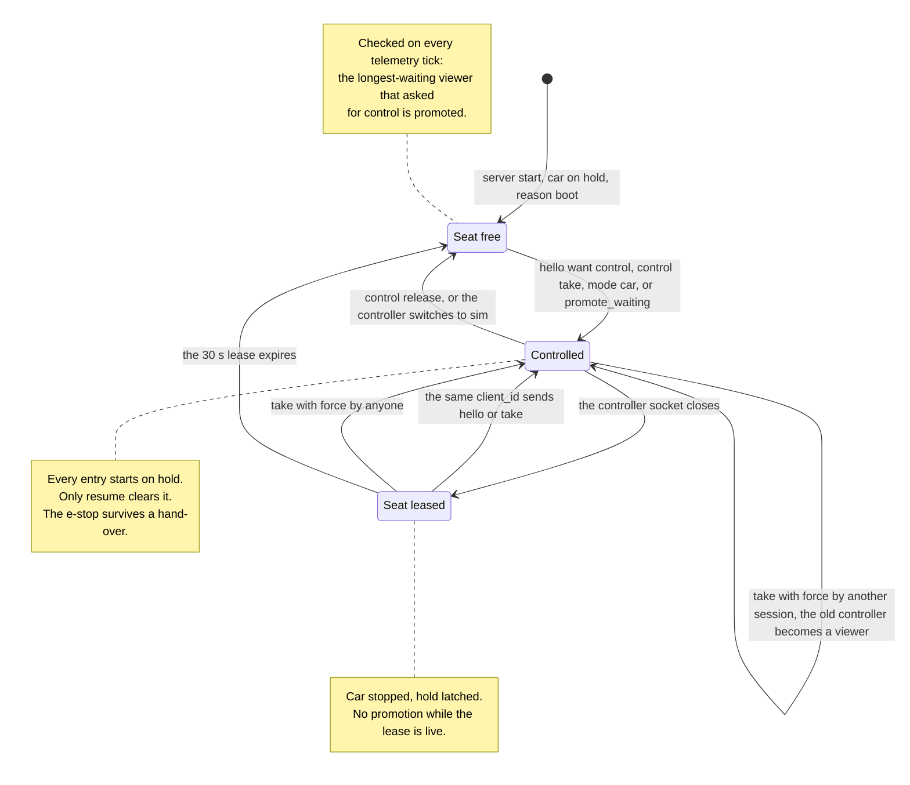

And one session's role:

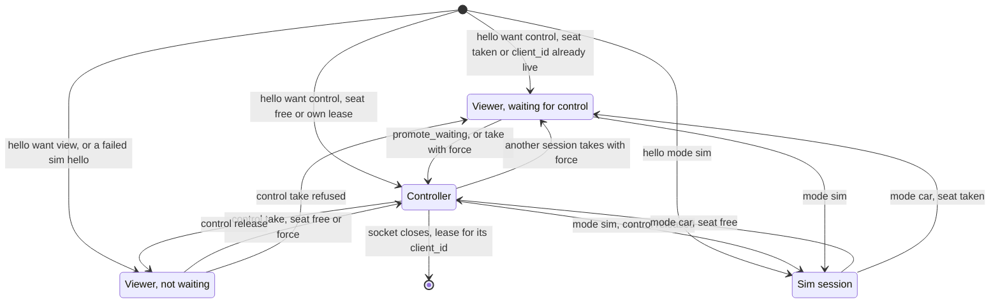

`Hub.take()` grants the seat when it is free and no other client holds a live lease, or always with `force`
(the car is stopped and held first). `Hub.detach()` turns a lost controller into a 30 s lease for its
`client_id`: an iPad tab that comes back gets the car again without `force`, on hold, with its config kept.
`Hub.promote_waiting()` runs on every telemetry tick: when there is no controller and no live lease it hands the
car to the longest-waiting car-mode session that asked for control (hello order), never to one that sent
`control release` or to a duplicate of a live `client_id`. This promotion was added on the car on 2026-11-21:
without it a tab opened during a lease stayed VIEW ONLY and could not reset an e-stop. The rules are specified in
[protocol.md](protocol.md) section 2.

The hold latch is set with a reason and cleared only by `resume` (the Resume button, the green flag, or
`wsclient drive`/`move`):

| Reason | Set by |
|---|---|
| `boot` | server start (`Controller(start_on_hold=True)`) |
| `control` | every acquisition of the seat (`new_controller`), a forced take-over, a release |
| `pause` | `cmd pause` (CarLink sends it when the page is hidden) |
| `watchdog` | the tick watchdog, or the sensor thread's deadline probe |
| `disconnect` | the controller's socket closed (`controller_lost`) |

The e-stop is a separate latch: anyone can set it (any mode, viewers, `POST /api/estop`), only the controller
can clear it with `estop_reset`. The GUI shows **Reset** next to E-STOP while it is latched and this session may
reset it.

## 7. Build and deployment

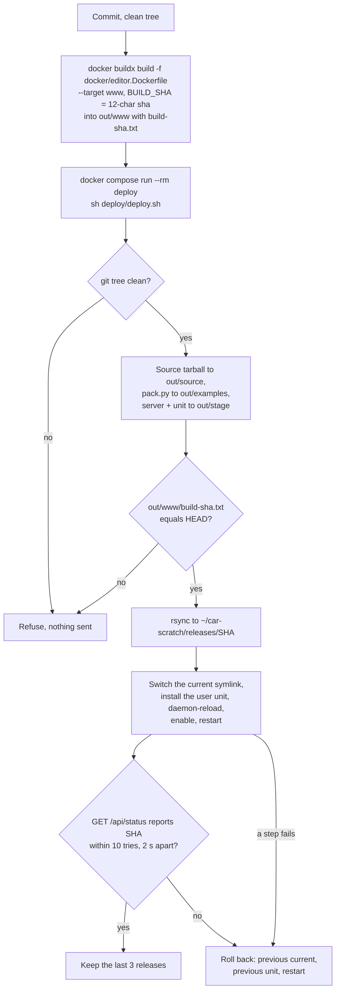

The editor is built on the workstation (the Pi 3 cannot run webpack) with
`--build-arg BUILD_SHA=$(git rev-parse --short=12 HEAD)`; `deploy.sh` refuses a bundle built from any other
commit. The deploy container (`docker/deploy.Dockerfile`) runs the whole script; without arguments
(`docker compose run --rm deploy`) it is a dry run that prints the plan and contacts nothing. `PICAR_HOST` and
`PICAR_USER` choose the target.

What a release looks like on the car:

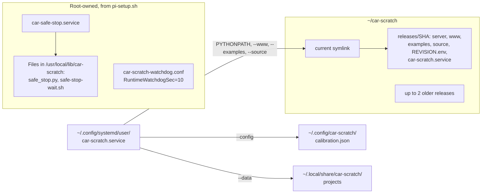

`REVISION.env` carries `CAR_SCRATCH_SHA`, which the server reports as `server.sha` and in `/api/status`; the
browser compares it with its own build sha and asks for a reload on a mismatch. Calibration and saved projects
live outside the releases, so a deploy or a rollback never touches them.

One-time setup on the Pi, run with `sudo`:

- [deploy/pi-setup.sh](../deploy/pi-setup.sh) (idempotent): apt packages (`python3-aiohttp`, `python3-smbus2`,
  `rsync`, `python3-rpi-lgpio`), linger for the car user (the user unit starts at boot), Wi-Fi power-save off
  (its latency spikes would trip the 750 ms watchdog), the directories above, the hardware watchdog drop-in, and
  the boot-time `car-safe-stop.service` with a root-owned copy of `safe_stop.py`. Re-run it after a deploy that
  changes `safe_stop.py`.
- [deploy/ops-user-setup.sh](../deploy/ops-user-setup.sh): the optional `carops` maintenance account (SSH key
  only, keys limited to the home LAN with `from=`, passwordless sudo validated with `visudo`); `--remove` deletes
  it again.

## 8. Where things live

```
editor/packages/scratch-vm/src/extensions/scratch3_picar/   blocks (index.js), CarLink, protocol constants
editor/packages/scratch-gui/src/components/car-monitor/      Car Monitor, E-STOP button, banners, canvas, room map
editor/packages/scratch-gui/src/components/car-projects-modal/   Save to car / Open from car
editor/packages/scratch-gui/src/components/menu-bar/examples-menu.jsx   Examples menu
editor/packages/scratch-gui/src/components/stage-pane-tabs/  Sprites | Pi Car tabs
editor/packages/scratch-gui/src/containers/                  car-monitor.jsx, car-estop.jsx, picar-global.jsx
editor/packages/scratch-gui/src/lib/picar/                   link hooks, REST helpers, storage helpers
server/picar_server/                 app, protocol, session, controller, safety, config, power, projects,
                                     safe_stop, sdnotify
server/picar_server/hal/             base, pca9685, sensors, real, dryrun
server/picar_server/hal/sim/         simulator backend, world geometry, worlds/*.json
server/tools/                        wsclient.py, calib.py
server/tests/                        pytest suite
server/legacy/                       the original hardware test scripts (not deployed)
examples/defs/, examples/tools/      example definitions; sb3.py DSL and pack.py
e2e/tests/, e2e/probe/, e2e/oncar/   Playwright: default suite, simulator probes, real-car checks
deploy/                              deploy.sh, test-deploy.sh, pi-setup.sh, ops-user-setup.sh, the user unit
docker/, compose.yaml                editor, server and deploy images; dev, test, simulator, deploy services
assets/branding/                     icons and the car sprite used by the examples
out/                                 build output, gitignored: www/, examples/, source/, stage/, e2e/
```
